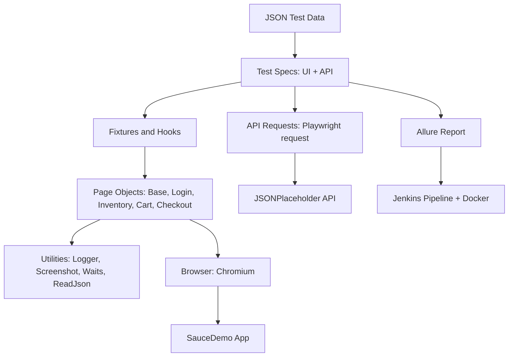

# SauceDemo Playwright Automation Framework

UI + API test automation framework built with **Playwright (JavaScript)**.
Software Testing Course project (November 2026).

- **UI app under test:** https://www.saucedemo.com (online shopping site)
- **API under test:** https://jsonplaceholder.typicode.com (REST API)
- **Total tests:** 20 (12 UI + 8 API)

## Project Objectives
1. Automate end-to-end testing of an online shopping application.
2. Implement API testing for RESTful endpoints.
3. Apply the Page Object Model (POM) design pattern.
4. Implement data-driven testing using JSON files.
5. Use reusable fixtures and hooks for test setup and teardown.
6. Create reusable utility functions for common operations.
7. Generate test reports using Allure and the Playwright HTML reporter.
8. Containerize the framework using Docker.
9. Integrate the framework with Jenkins for CI/CD automation.

## Features
| Requirement | Where it is |
|---|---|
| Page Object Model | `pages/` |
| Data-driven testing (JSON) | `testdata/*.json` read by `utilities/readJson.js` |
| Hooks | `fixtures/testSetup.js` (beforeEach, afterEach) and `tests/ui/login.spec.js` (beforeAll, afterAll) |
| Utilities layer | Logger, screenshot, waits, JSON reader, API helper (`utilities/`) |
| Reusable core methods | Navigation, click/type with waits, logout and dialog handling in `pages/BasePage.js`; login in `pages/LoginPage.js` |
| API automation | GET, POST, PUT, PATCH, DELETE using the Playwright `request` fixture |
| Schema validation | JSON schema validation with Ajv (`testdata/schemas/post.schema.json`) |
| Response validation | Status codes, body, headers, response time |
| Reporting | Allure + Playwright HTML (UI and API in the same report), see `playwright.config.js` |
| Docker | `Dockerfile`, `.dockerignore` |
| CI/CD | Declarative Jenkins pipeline in `Jenkinsfile` |

## Architecture
The framework is layered: test data, test specs, fixtures, page objects, utilities, browser/API interactions and reporting work together.



| Component | Role |
|---|---|
| Test Data | Test inputs and expected results stored as JSON |
| Test Specifications | UI and API test cases |
| Fixtures and Hooks | Create page objects, handle setup and cleanup |
| Page Objects | Locators and actions for each page |
| Utilities | Logging, screenshots, waits, data reading, API helpers |
| Browser | Chromium executes the UI automation |
| API Layer | HTTP requests and response validation |
| Reporting | Allure and Playwright HTML reports |
| CI/CD | Jenkins runs the pipeline using Docker |

## Folder structure
```
saucedemo-framework/
|-- tests/
|   |-- ui/
|   |   |-- login.spec.js
|   |   |-- inventory.spec.js
|   |   `-- checkout.spec.js
|   `-- api/
|       `-- posts.api.spec.js
|-- pages/
|   |-- BasePage.js
|   |-- LoginPage.js
|   |-- InventoryPage.js
|   |-- CartPage.js
|   `-- CheckoutPage.js
|-- fixtures/
|   `-- testSetup.js
|-- utilities/
|   |-- logger.js
|   |-- screenshot.js
|   |-- waits.js
|   |-- readJson.js
|   `-- apiHelper.js
|-- testdata/
|   |-- loginData.json
|   |-- checkoutData.json
|   |-- apiData.json
|   `-- schemas/
|       `-- post.schema.json
|-- Dockerfile
|-- .dockerignore
|-- Jenkinsfile
|-- playwright.config.js
`-- package.json
```

## Technologies Used
| Technology | Purpose |
|---|---|
| JavaScript | Automation language |
| Playwright | UI and API testing framework |
| Node.js | JavaScript runtime |
| JSON and Ajv | Test data storage and JSON schema validation |
| Allure | Test execution reporting |
| Docker | Containerization of the framework |
| Jenkins | Continuous integration pipeline |
| Chromium | Browser used for UI automation |
| Git and GitHub | Version control and source repository |

## Setup
Requirements:
- Node.js LTS
- Java 21 or newer (required by the Allure command line)
- Git
- Docker Desktop
- Jenkins (for the CI/CD pipeline)

```bash
npm install
npx playwright install chromium
```

## Run the tests
```bash
npm test               # all 20 tests (UI + API)
npm run test:ui        # UI tests only
npm run test:api       # API tests only
npm run test:headed    # UI tests with a visible browser
```

## UI Test Automation
The UI tests validate the SauceDemo online shopping application.

| ID | Test scenario |
|---|---|
| UI-01 | Login with valid user `standard_user` (data-driven) |
| UI-02 | Login with valid user `problem_user` (data-driven) |
| UI-03 | Login fails for a locked-out user |
| UI-04 | Login fails with a wrong password |
| UI-05 | Login fails with an empty username |
| UI-06 | Inventory page shows all 6 products |
| UI-07 | Sort products by price (low to high) |
| UI-08 | Add a product and verify the cart badge shows 1 |
| UI-09 | Remove a product and verify the cart badge disappears |
| UI-10 | Log out successfully |
| UI-11 | Complete a checkout end to end |
| UI-12 | Checkout is blocked when the first name is empty |

**Workflow:** open SauceDemo > enter login credentials read from JSON > verify the authentication result > validate the inventory products > perform cart operations > go through checkout > verify the expected outcomes.

## API Test Automation
The framework tests REST endpoints with Playwright's built-in `request` fixture (APIRequestContext). Base URL: https://jsonplaceholder.typicode.com

| ID | Test scenario |
|---|---|
| API-01 | GET all posts (status, content-type header, response time, count) |
| API-02 | GET a single post and validate it against the JSON schema |
| API-03 | GET a non-existing post and verify 404 |
| API-04 | GET posts filtered by `userId` |
| API-05 | POST a new post (status 201, body, schema) |
| API-06 | PUT (replace) an existing post |
| API-07 | PATCH (partially update) an existing post |
| API-08 | DELETE a post |

**Validation:** HTTP status codes, response body values, JSON schema (Ajv), response headers (content type), response time (less than 3 seconds).
Endpoints, request payloads and expected results are stored in `testdata/apiData.json`.

## Data-Driven Testing
JSON files keep test data separate from test logic.
- `loginData.json`: valid users, and invalid users with the expected error message.
- `checkoutData.json`: product, customer details and expected confirmation text.
- `apiData.json`: API endpoints, request payloads and expected status codes.
- Data is loaded by the reusable `readJson()` utility, and one test is generated for every record.

## Page Object Model
`BasePage.js` holds the reusable core methods shared by all pages:
- Navigation (`navigate`)
- Click and type with explicit waits (`click`, `type`)
- Logout through the burger menu (`logout`)
- Alert/popup handling (`handleNextDialog`)

Page classes:
- `LoginPage.js`: open the site and log in
- `InventoryPage.js`: product list, sorting, add/remove from cart, cart badge
- `CartPage.js`: cart items and starting checkout
- `CheckoutPage.js`: customer information, finishing the order, error and confirmation messages

## Fixtures and Hooks
Custom fixtures in `fixtures/testSetup.js` create a fresh page object for every test and provide a `loggedInInventory` shortcut that logs in before the test starts.

| Hook | Purpose in this project |
|---|---|
| beforeAll | Logs the start of the login suite (`login.spec.js`) |
| afterAll | Logs the end of the login suite (`login.spec.js`) |
| beforeEach | Logs the start of every test (`testSetup.js`) |
| afterEach | Attaches a screenshot to the report, saves a PNG to `screenshots/` on failure and logs the result |

Browser setup and closing is handled by Playwright's `page` fixture. Because tests run in parallel workers, `beforeAll` and `afterAll` run once per worker.

## Utilities Layer
- **Logger** (`logger.js`): writes to the console and to `logs/test-run.log`.
- **Screenshot utility** (`screenshot.js`): step screenshots and failure screenshots.
- **Wait utility** (`waits.js`): explicit waits for visibility, URL and network idle. Implicit waits come from Playwright's auto-wait and the configured action timeout.
- **JSON reader** (`readJson.js`): loads files from `testdata/`.
- **API helper** (`apiHelper.js`): JSON schema validation and attaching API responses to the report.

## Reports
Allure shows the test summary, pass/fail results, steps, execution time, logs and failure screenshots. UI and API tests appear in the same report.

```bash
npm run report               # generates allure-report/ and opens it
npx playwright show-report   # Playwright HTML report
```

Failure artifacts:
- Screenshots: `screenshots/`
- Logs: `logs/test-run.log`
- Reports: `allure-results/`, `playwright-report/`

## Docker
Docker runs the framework in a consistent environment, based on the official Playwright image.

```bash
docker build -t saucedemo-playwright .
docker run --rm saucedemo-playwright
```

The Playwright version in the `Dockerfile` image tag must match the version installed in the project (`npm ls @playwright/test`). In the verified run, all 20 tests passed inside the container.

## Jenkins
1. Install plugins: Pipeline, Git, GitHub, Allure Jenkins Plugin. Add an Allure Commandline tool named `allure` (Manage Jenkins > Tools).
2. New Item > Pipeline > "Pipeline script from SCM" > Git > repo URL + credentials, branch `*/main`, Script Path `Jenkinsfile`.
3. Triggers in the `Jenkinsfile`: GitHub push (`githubPush()`, webhook via ngrok) and a nightly schedule (`cron('H 2 * * *')`).

Pipeline stages:
1. **Checkout:** pull the code from GitHub.
2. **Build Docker Image:** build the image from the `Dockerfile`.
3. **Run UI + API Tests:** run all 20 tests inside the container.
4. **Post Actions:** copy reports, screenshots and logs out of the container, archive them, and publish the Allure report.

```
Checkout --> Build Docker Image --> Run UI and API Tests
         --> Publish Allure Report --> Archive Screenshots and Logs
```

The `Jenkinsfile` uses `bat` commands because Jenkins was installed on Windows. On Linux, replace `bat` with `sh` and `%VAR%` with `$VAR`.

## Documentation and evidence (`docs/`)
| File | What it contains |
|---|---|
| `docs/Project_Documentation.pdf` | Architecture, Docker build and run evidence, Allure reports |
| `docs/README_Framework_Guide.pdf` | Full framework guide (setup, structure, test list, Docker, Jenkins) |
| `docs/Jenkins_Pipeline_Screenshots.pdf` | Successful Jenkins run, Allure report in Jenkins, archived artifacts |
| `docs/Playwright_HTML_Test_Report.html` | Playwright HTML report: 20 of 20 tests passed |

## Conclusion
The framework combines the Page Object Model, JSON data-driven testing, fixtures and hooks, reusable utilities, API validation, Allure reporting, Docker containerization and Jenkins CI/CD. The result is a maintainable and scalable approach that can be extended for future testing needs.
