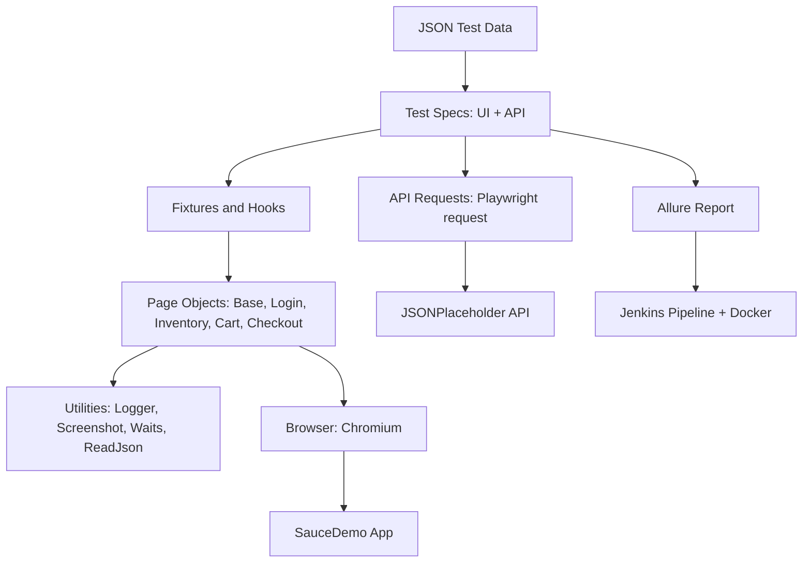

# SauceDemo Playwright Automation Framework

UI + API test automation framework built with **Playwright (JavaScript)**.
Software Testing Course project.

- **UI app under test:** https://www.saucedemo.com (online shopping site)
- **API under test:** https://jsonplaceholder.typicode.com
- **Total tests:** 20 (12 UI + 8 API)

## Features
| Requirement | Where it is |
|---|---|
| Page Object Model | `pages/` |
| Data-driven testing (JSON) | `testdata/` + `utilities/readJson.js` |
| Hooks (beforeAll / afterAll / beforeEach / afterEach) | `fixtures/testSetup.js`, `tests/ui/login.spec.js` |
| Utilities layer (logger, screenshots, waits) | `utilities/` |
| Reusable core methods (navigation, login/logout, waits, alerts) | `pages/BasePage.js`, `pages/LoginPage.js` |
| API automation (GET, POST, PUT, PATCH, DELETE + schema, headers, response time) | `tests/api/` |
| Reporting (Allure + Playwright HTML) | `playwright.config.js` |
| Docker | `Dockerfile`, `.dockerignore` |
| Jenkins pipeline | `Jenkinsfile` |

## Architecture


## Folder structure
```
tests/ui        UI test specs (login, inventory, checkout)
tests/api       API test specs
pages/          Page objects (BasePage and one class per page)
fixtures/       Custom fixtures + global hooks
utilities/      Logger, screenshot, waits, JSON reader, API helper
testdata/       JSON test data + JSON schema
Dockerfile      Container for running the whole suite
Jenkinsfile     Declarative CI/CD pipeline
```

## Setup
Requirements: Node.js LTS, Java (needed only for the Allure report), Git, Docker Desktop (for Docker/Jenkins).

```bash
npm install
npx playwright install chromium
```

## Run the tests
```bash
npm test               # all 20 tests (UI + API)
npm run test:ui        # UI only
npm run test:api       # API only
npm run test:headed    # UI with a visible browser
```

## Reports
```bash
npm run report         # generates allure-report/ and opens it
npx playwright show-report   # Playwright HTML report
```
Failure screenshots are saved in `screenshots/`, logs in `logs/test-run.log`.

## Docker
```bash
docker build -t saucedemo-playwright .
docker run --rm saucedemo-playwright
```
The base image tag in the `Dockerfile` must match the Playwright version (`npm ls @playwright/test`).

## Jenkins
1. Install plugins: Pipeline, Git, GitHub, Allure Jenkins Plugin. Add an Allure Commandline tool (Manage Jenkins > Tools).
2. New Item > Pipeline > "Pipeline script from SCM" > Git > repo URL + credentials, branch `*/main`, Script Path `Jenkinsfile`.
3. Enable "GitHub hook trigger for GITScm polling" (webhook via ngrok) - the pipeline also runs nightly.
4. Pipeline stages: Checkout > Build Docker Image > Run UI + API Tests > publish Allure report, archive screenshots and logs.
The Jenkinsfile uses `bat` (Windows). On Linux replace `bat` with `sh` and `%VAR%` with `$VAR`.

## Test list
**UI (12):** 2 valid logins, 3 invalid logins, 6 products shown, sort by price, add to cart, remove from cart, logout, full checkout, checkout with missing first name.
**API (8):** GET all, GET single + schema, GET 404, GET filtered, POST, PUT, PATCH, DELETE.
